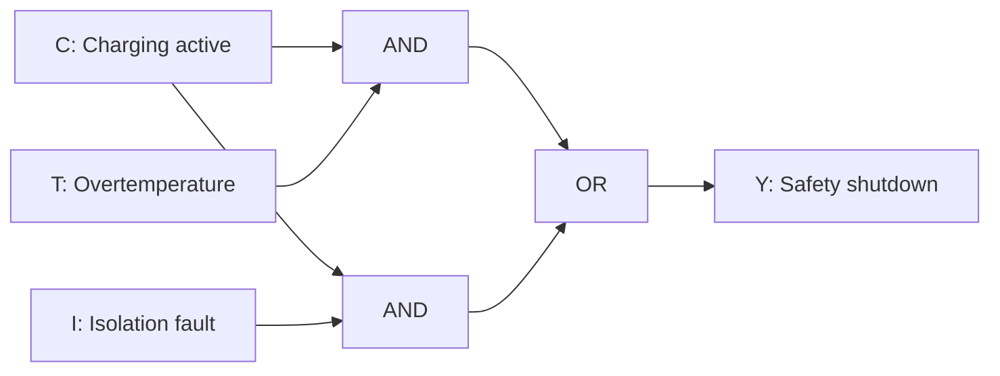

# Task B: EV Charger Safety Shutdown Circuit

## Purpose

This circuit represents a basic safety shutdown function for an EV charging system. It checks whether charging is active and whether an overtemperature condition or an isolation fault has been detected.

## Inputs and Output

| Symbol | Meaning |
|---|---|
| `C` | Charging is active |
| `T` | Overtemperature is detected |
| `I` | Isolation fault is detected |
| `Y` | Safety shutdown is activated |

## Boolean Expression

The Boolean expression for the circuit is:

`Y = CT + CI`

This can also be written as:

`Y = C(T + I)`

The two intermediate outputs are:

- `D1 = CT`
- `D2 = CI`

The final output is:

`Y = D1 + D2`

## Logic Structure

## Truth Table

| C | T | I | D1 = CT | D2 = CI | Y |
|---:|---:|---:|---:|---:|---:|
| 0 | 0 | 0 | 0 | 0 | 0 |
| 0 | 0 | 1 | 0 | 0 | 0 |
| 0 | 1 | 0 | 0 | 0 | 0 |
| 0 | 1 | 1 | 0 | 0 | 0 |
| 1 | 0 | 0 | 0 | 0 | 0 |
| 1 | 0 | 1 | 0 | 1 | 1 |
| 1 | 1 | 0 | 1 | 0 | 1 |
| 1 | 1 | 1 | 1 | 1 | 1 |

## Explanation

The circuit uses three inputs to determine whether the safety shutdown output should be activated. Input `C` shows whether a charging session is active. Input `T` represents an overtemperature condition, while input `I` represents an isolation fault.

Two AND gates are used. The first calculates `D1 = CT`, so it produces an output of 1 only when charging is active and an overtemperature condition is present. The second calculates `D2 = CI`, producing an output of 1 when charging is active and an isolation fault is detected. The outputs of both AND gates are connected to an OR gate. Therefore, the final output is `Y = CT + CI`.

The truth table verifies all eight possible input combinations. When `C` is 0, the shutdown output remains 0 because there is no active charging session. When `C` is 1, either `T` or `I` can activate the output. For example, the combination `C = 1`, `T = 1` and `I = 0` produces `Y = 1`. If all three inputs are 1, both intermediate conditions are true and the shutdown remains active. This design shows how Boolean logic can represent a practical safety decision.