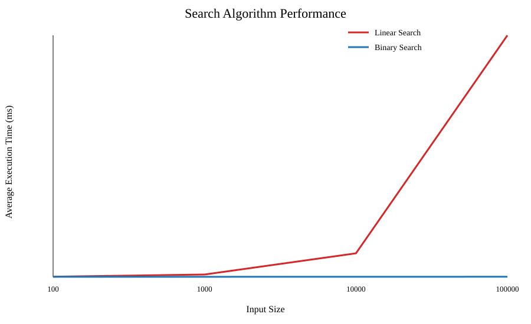

# Unit 3: Algorithm Design and Performance Analysis

## Activity

This activity implements and compares Linear Search and Binary Search in Python. Synthetic EV charger serial numbers are used to avoid including confidential operational data.

## Files

- [Linear Search implementation](linear-search.py)
- [Binary Search implementation](binary-search.py)
- [Performance test](performance-test.py)
- [Performance results](performance-results.csv)
- [Performance graph](performance-comparison.svg)

## Performance Graph

## Report

Linear Search and Binary Search were implemented to locate an EV charger record within a dataset. Linear Search examines each item in sequence until it finds the target or reaches the end of the list. It works with both sorted and unsorted data. Binary Search examines the middle item and repeatedly removes half of the remaining search area. However, this method requires the dataset to be sorted.

The theoretical worst-case time complexity of Linear Search is O(n), because the number of comparisons may increase directly with the input size. Binary Search has a worst-case complexity of O(log n), as each comparison reduces the remaining search area by half (Cormen et al., 2022). The textbook provides a rigorous basis for this theoretical comparison, although complexity notation does not represent hardware conditions or exact execution times.

A Python performance test was therefore used to compare the algorithms with input sizes from 100 to 100,000 records. The target was placed at the end of each dataset, representing a worst-case scenario for Linear Search. Execution time was measured repeatedly using `time.perf_counter()`, which Python describes as a high-resolution counter for measuring short durations (Python Software Foundation, 2026). The generated graph showed that Linear Search time increased more noticeably as the dataset grew, while Binary Search remained comparatively stable.

In my view, Linear Search is suitable for small charger lists because it is simple and does not require sorted data. Binary Search is more appropriate for a large, sorted charger database because it requires fewer comparisons. However, this experiment excludes the time needed to sort an unsorted dataset. It was also conducted on one computer using synthetic data and a fixed target position. The results therefore support the theoretical comparison but should not be treated as universal benchmark values.

## References

Cormen, T.H., Leiserson, C.E., Rivest, R.L. and Stein, C. (2022) *Introduction to Algorithms*. 4th edn. Cambridge, MA: MIT Press. Available at: https://mitpress.mit.edu/9780262046305/introduction-to-algorithms/ (Accessed: 19 September 2026).

Python Software Foundation (2026) *time — Time access and conversions*. Available at: https://docs.python.org/3/library/time.html#time.perf_counter (Accessed: 19 September 2026).