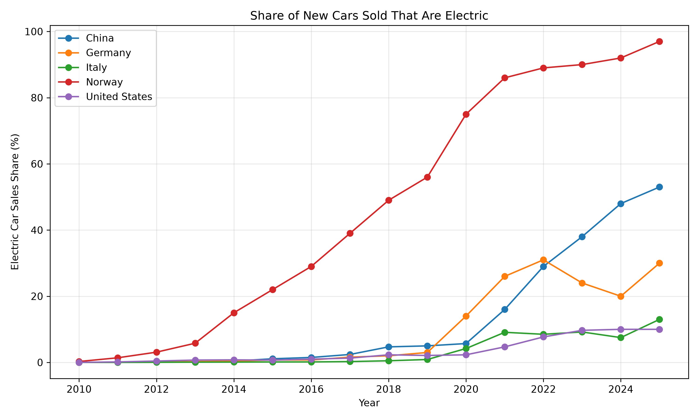
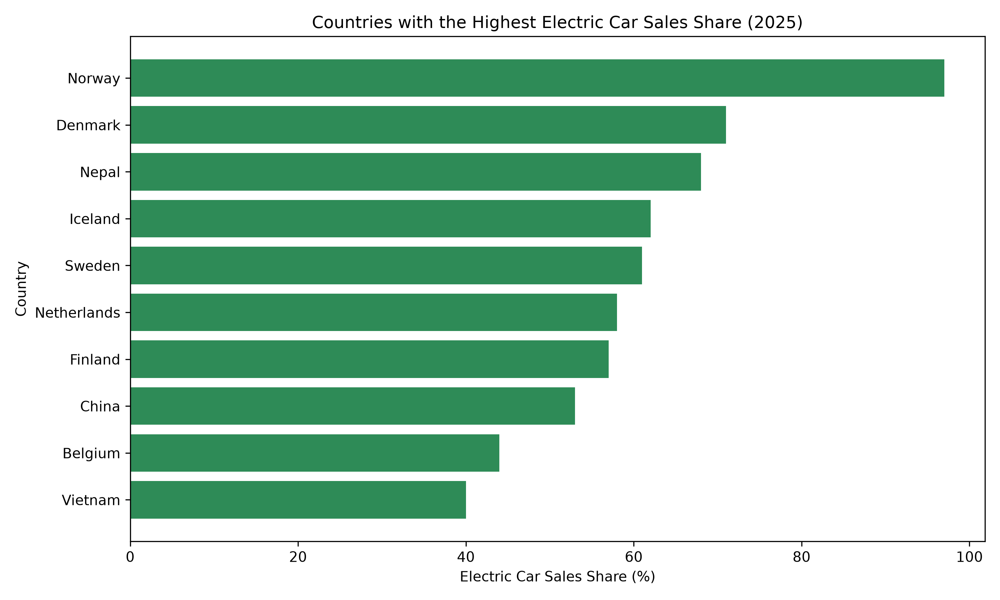

# Unit 5: Electric Vehicle Data Analysis

## Project Overview

This project analyses the share of new cars sold that are electric in different countries. Python, Pandas and Matplotlib were used to load, clean, analyse and visualise the data.

The dataset was downloaded from Our World in Data and is based on information from the International Energy Agency.

## Dataset

The dataset contains the following main fields:

- `Entity`: country or region
- `Code`: country code
- `Year`: year of observation
- `EV_Sales_Share`: percentage of new cars sold that were electric

Data source: [Our World in Data – Share of new cars sold that are electric](https://ourworldindata.org/grapher/electric-car-sales-share)

## Data Cleaning

The program completed the following cleaning operations:

- Converted the year and EV sales share columns to numeric values
- Removed rows with missing essential values
- Removed duplicate records
- Renamed the measurement column to `EV_Sales_Share`
- Saved the cleaned data as a separate CSV file

The original dataset was not overwritten. This makes it possible to compare the source data with the cleaned version.

## Basic Analysis

Five countries were selected for comparison: China, Germany, Italy, Norway and the United States.

| Country | Mean (%) | Median (%) | Minimum (%) | Maximum (%) |
|---|---:|---:|---:|---:|
| China | 12.81 | 3.55 | 0.01 | 53.00 |
| Germany | 9.62 | 1.80 | 0.00 | 31.00 |
| Italy | 3.35 | 0.38 | 0.00 | 13.00 |
| Norway | 46.85 | 44.00 | 0.28 | 97.00 |
| United States | 3.37 | 1.70 | 0.01 | 10.00 |

Norway had the highest mean and maximum EV sales shares. China’s mean was considerably higher than its median, which indicates that much of its growth occurred in the later observations.

## Correlation Analysis

The correlation between year and EV sales share was positive for every selected country.

| Country | Correlation |
|---|---:|
| China | 0.849 |
| Germany | 0.859 |
| Italy | 0.863 |
| Norway | 0.983 |
| United States | 0.895 |

Norway had the strongest relationship between year and EV sales share. However, correlation does not establish causation. Government policy, vehicle prices, charging infrastructure and consumer demand may also influence EV adoption.

## Visualisations

### EV Sales Trends

The line chart compares changes in EV sales share across the five selected countries.

### Countries with the Highest EV Sales Share

The bar chart compares the ten countries with the highest EV sales share in the latest year available in the dataset.

## Limitations

The countries may not contain identical reporting periods. This can affect comparisons between their mean values. The dataset also describes the percentage of new vehicles sold, not the total number of electric vehicles or the availability of charging infrastructure. The analysis identifies patterns but does not explain their causes.

## Files

- [`analysis.py`](analysis.py): Python analysis and visualisation code
- [`data/electric-car-sales-share.csv`](data/electric-car-sales-share.csv): original dataset
- [`outputs/cleaned-ev-data.csv`](outputs/cleaned-ev-data.csv): cleaned dataset
- [`outputs/summary-statistics.csv`](outputs/summary-statistics.csv): descriptive statistics
- [`outputs/correlations.csv`](outputs/correlations.csv): correlation results
- [`reflection.md`](reflection.md): comparison of SQL and NoSQL storage models