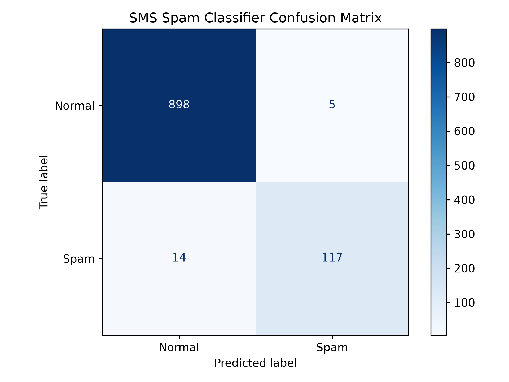

# Unit 6: SMS Spam Classification

## Project Overview

This project implements a simple machine-learning model that classifies SMS messages as either spam or normal. It was adapted from the sample spam-classifier code provided in Unit 6.

The project uses Python and Scikit-learn. The original sample used five manually written messages, whereas this version uses the publicly available SMS Spam Collection from the UCI Machine Learning Repository.

## Dataset

The original dataset contains 5,574 labelled SMS messages:

- `ham`: a normal message
- `spam`: an unwanted message

After duplicate and incomplete records were removed, 5,169 messages remained.

Dataset source:

[UCI SMS Spam Collection](https://archive.ics.uci.edu/dataset/228/sms+spam+collection)

## Model

The model uses:

- `CountVectorizer` to convert message text into numerical word counts.
- `MultinomialNB` to classify each message.
- An 80/20 train-test split.
- A fixed random state to make the results reproducible.

## Performance Results

| Metric | Result |
|---|---:|
| Accuracy | 98.2% |
| Precision | 95.9% |
| Recall | 89.3% |
| Training messages | 4,135 |
| Testing messages | 1,034 |

The confusion matrix showed:

| Result | Number of messages |
|---|---:|
| Normal messages correctly classified | 898 |
| Spam messages correctly classified | 117 |
| Normal messages incorrectly classified as spam | 5 |
| Spam messages incorrectly classified as normal | 14 |

## Confusion Matrix



## Project Structure

```text
unit-06/
├── data/
│   └── SMSSpamCollection
├── outputs/
│   ├── confusion-matrix.png
│   └── performance-metrics.csv
├── analysis.md
├── README.md
└── spam_classifier.py

Requirements

The project requires:

Python
pandas
matplotlib
scikit-learn

Install the required packages with:

python -m pip install pandas matplotlib scikit-learn
Running the Project

Open a terminal in the repository's main folder and run:

python unit-06/spam_classifier.py

The program displays the performance metrics and example predictions. It also saves the metrics and confusion matrix in the outputs folder.

Limitations and Ethical Considerations

The model may incorrectly place an important normal message in the spam folder or allow dangerous spam to reach the inbox. Both errors can affect users. The dataset is also relatively old and mainly contains English-language messages, so the model may perform less accurately with current scams, other languages or different communication styles.

The full evaluation is available in analysis.md.

Reference

Almeida, T. and Hidalgo, J. (2011) SMS Spam Collection [Dataset]. UCI Machine Learning Repository. Available at: https://doi.org/10.24432/C5CC84 (Accessed: 23 September 2026).